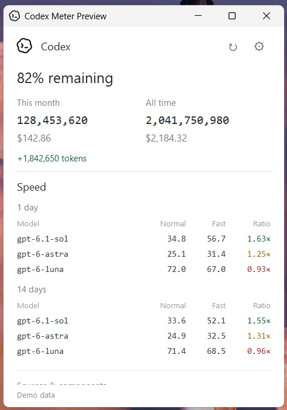

# Codex Meter

A small Windows desktop meter for Codex usage and speed. Close it to the notification area and reopen it from the desktop shortcut.



*Actual app window with synthetic demo data. The source credits are below the data.*

## Quick install / 快速安装

1. Download **[Codex-Meter-Windows-x64.zip](https://github.com/HenryTeo27/ai-agent-usage-speed-app/releases/latest/download/Codex-Meter-Windows-x64.zip)** from [Releases](https://github.com/HenryTeo27/ai-agent-usage-speed-app/releases/latest).
2. Extract the ZIP, then double-click **Install.cmd**. No administrator access or Python installation is needed.
3. Open **Codex Meter** on your desktop. The installer also adds it to the Start menu.

下载 ZIP → 解压 → 双击 `Install.cmd` → 从桌面打开 **Codex Meter**。

**Requires Windows 10/11 x64, Node.js 22+ with npm, and Codex installed and signed in.** Restart the app after installing Node.js so it can find `npx`. Codex Desktop's bundled CLI is detected when it is not on PATH. This app uses your local Codex logs; it cannot recover activity from other computers or deleted logs.

Python and the speed tool's libraries are included in the release. codex-speed is downloaded automatically on its first scan. First use needs internet access. Keep the entire extracted folder if running the app directly from `CodexMeter/CodexMeter.exe`; after installing, the extracted ZIP folder can be removed.

## Use

- **↻** refreshes usage, account limits and speed. Previous results stay visible while scanning.
- **⚙** selects manual refresh or every 2, 4, 6, 8 or 12 hours. It also sets the all-time token adjustment.
- Only one app window runs at a time. Opening another copy restores the existing window, including one hidden in the tray.
- Closing the window hides it in the notification area. Use **Open**, **Refresh** or **Quit** from the tray menu.
- Hover over speed values for units and sample counts. Hover over the green token change for “Since Last Refresh”.
- The 1-day speed table appears above the 14-day table. Mouse-wheel scrolling reaches the source credits below the data. There is no visible scrollbar.
- The app does not start with Windows. Scheduled scans run while it is open or in the tray. Opening recent results does not start another scan.

## Install with Codex or from source

Ask your local coding agent:

> Clone https://github.com/HenryTeo27/ai-agent-usage-speed-app and run install.ps1 on Windows. Check Python 3.10+ with Tk, Node.js 22+ and my signed-in Codex installation. Install dependencies and create the desktop shortcut.

Or [download the source ZIP](https://github.com/HenryTeo27/ai-agent-usage-speed-app/archive/refs/heads/main.zip), extract it and double-click `Install.cmd`. Source installation needs Python 3.10+ with Tk; it can also use a supported Codex-bundled Python. It creates a private Python environment and installs `requirements.txt`.

```powershell
git clone https://github.com/HenryTeo27/ai-agent-usage-speed-app.git
cd ai-agent-usage-speed-app
powershell -NoProfile -ExecutionPolicy Bypass -File .\install.ps1
```

Both installers place the app in `%LOCALAPPDATA%\Programs\CodexMeter` and add desktop and Start menu shortcuts. To update, quit the app from its tray menu, download the new release and run its installer. To remove it, quit it and delete that folder and the two shortcuts. Settings and the latest snapshot are in `%LOCALAPPDATA%\CodexMeter`; delete that folder too if you want to reset everything.

## Data sources and calculations

| Display | Source |
| --- | --- |
| Remaining allowance | `100 − usedPercent` from local Codex `account/rateLimits/read` |
| This month / all time tokens and USD | `npx --yes ccusage@latest codex monthly --json` |
| Normal / Fast speed | [codex-speed by pszemraj](https://gist.github.com/pszemraj/f8fe69ff5002c3bd0825edfd02001635), Selected history, 1 and 14 calendar days |
| Ratio | Fast median effective tokens/s ÷ Normal median effective tokens/s |
| Green token change | Difference in raw all-time tokens between the latest two successful usage scans |

Costs are estimated API-equivalent costs from [ccusage](https://github.com/ccusage/ccusage), not your subscription invoice. They may use fallback model prices. Speed values are client-side estimates from local timestamps, including waiting, using samples with at least 100 output tokens. Different workloads, reasoning settings, context sizes and sample counts can change the comparison. Recorded Fast settings do not confirm server routing. A dot means no result. Ratios below 1 are dark red; 1 to below 1.5 are dark yellow; 1.5 and above are dark green.

**Reserve adjustment:** the default `600,000,000` tokens is a manual personal estimate added once to **all-time tokens only**. Change it in Settings, or set it to `0` for unadjusted counts. ccusage already counts some `gpt-reserve` events, so the estimate may overlap with recorded tokens. It changes neither monthly tokens nor USD costs.

Each refresh asks npm for the latest ccusage and downloads the latest upstream codex-speed script. The temporary speed copy receives a Windows timezone compatibility fix. A successful speed script is kept as an offline fallback; an existing local codex-speed installation can also serve as fallback. If latest tools are unavailable or incompatible, the status reports the fallback or failure. The app does not claim an older fallback is the latest version. Tool updates run upstream third-party code. Updating Codex itself and updating Codex Meter are separate steps.

## Storage and resource use

The app retains settings, one latest snapshot, and one working speed-tool script. It does not keep a scan history or copy chat content. Speed CSVs and parse caches are temporary and deleted after scans. Existing Codex logs are read in place. npm maintains its normal package cache. No telemetry or chat upload is implemented. npm, the speed download and ccusage pricing resolution may access the network; the Codex account query uses Codex's existing sign-in.

The app sleeps between scans and scans run outside the UI thread. Each scan still reads local logs and briefly uses CPU, disk and memory; large log collections can take longer. Commands have timeouts. Failed sources retain their previous values and show a status message. This release is unsigned; Windows may identify the download as an unrecognized app.

## Development and build

```powershell
python -m venv .venv
.\.venv\Scripts\Activate.ps1
pip install -r requirements.txt
python -m unittest -v test_meter
pip install pyinstaller
powershell -NoProfile -ExecutionPolicy Bypass -File scripts\build.ps1 -Python (Get-Command python).Source
```

The ZIP is written to `release/`. It contains a folder-based executable bundle, installer, docs and dependency licenses. The automated Windows build is in `.github/workflows/windows.yml`.

## Contribute other coding agents

Contributions for other coding agents are welcome. The current release supports **Codex only**. Help add your agent's usage and speed so one small app can show multiple platforms together.

Open an issue or pull request with the agent name, a link to its usage or speed tool, and a small anonymized log or JSON sample. Explain what the tokens, cost and timing values mean. Keep scans local, avoid storing history, handle missing fields, and include parser tests. Never include API keys, login files, chat content or personal logs. Provider data collection should stay separate from UI rendering so more agents can be added without duplicating the window.

欢迎使用其他 coding agent 的用户贡献 usage 和 speed 支持。当前只支持 Codex；你可以提交 issue 或 PR，说明使用的 agent、统计工具和数据格式，一起把它扩展成多平台的小型 meter。

## License and credits

Original code: [MIT](LICENSE). Third-party components retain their own licenses; see [THIRD_PARTY_NOTICES.md](THIRD_PARTY_NOTICES.md). Codex and OpenAI marks identify the service. This is an independent community app.
