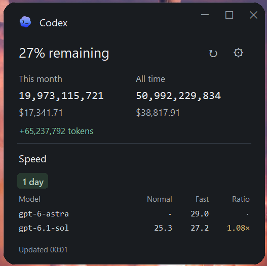
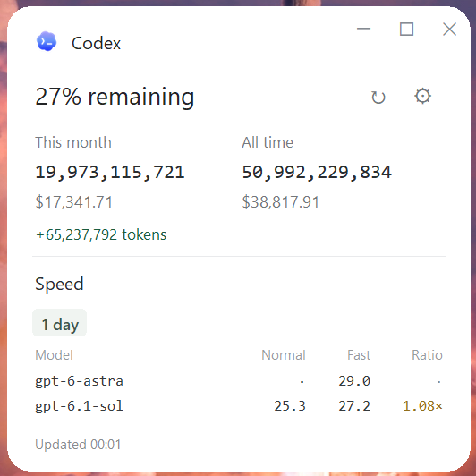

# Codex Meter

A small Windows desktop meter for Codex usage and speed. Close it to the notification area and reopen it from the desktop shortcut.

<p>
  
  
</p>

*Codex Meter in dark and light mode.*

The current interface uses slightly larger text and wider outer padding. The window starts at 500 pixels wide and fits the current 1-day speed table with a little bottom space. Scroll down to see 14 days. Refresh does not resize the window. Side margins remain 28 pixels; muted gray window controls stay flush with the top-right edge. Period badges have pill corners and the window uses a larger corner radius.

Appearance in Settings offers **System**, **Light** and **Dark**. System follows Windows' default app mode, including Custom mode. Light and Dark remain selected when Windows changes theme. Dark mode uses charcoal surfaces, lighter text and readable green, amber and red values. Switching appearance does not restart the app or scan logs.

The desktop shortcut, taskbar, tray, window and page header all use the same blue-purple gradient logo. The logo does not change with the theme. Its background and terminal cutouts use real alpha transparency, with no white box or checkerboard. The installer updates matching pinned shortcuts too. The selected PNG and multi-size ICO are in `assets/`.

Windows [registry change notifications](https://learn.microsoft.com/en-us/windows/win32/api/winreg/nf-winreg-regnotifychangekeyvalue) wake a waiting listener when theme preferences change. There is no periodic theme polling. If the preference or notification key cannot be read, startup falls back to light mode; opening from the tray checks the preference again. The app never changes your Windows theme settings.

## Quick install

1. Download **[Codex-Meter-Windows-x64.zip](https://github.com/HenryTeo27/ai-agent-usage-speed-app/releases/latest/download/Codex-Meter-Windows-x64.zip)** from [Releases](https://github.com/HenryTeo27/ai-agent-usage-speed-app/releases/latest).
2. Extract the ZIP, then double-click **Install.cmd**. No administrator access or Python installation is needed.
3. Open **Codex Meter** on your desktop. The installer also adds it to the Start menu.


**Requires Windows 10/11 x64, Node.js 22+ with npm, and Codex installed and signed in.** Restart the app after installing Node.js so it can find `npx`. Codex Desktop's bundled CLI is detected when it is not on PATH. This app uses your local Codex logs; it cannot recover activity from other computers or deleted logs.

Python and the speed tool's libraries are included in the release. codex-speed is downloaded automatically on its first scan. First use needs internet access. Keep the entire extracted folder if running the app directly from `CodexMeter/CodexMeter.exe`; after installing, the extracted ZIP folder can be removed.

## Use

- Drag the Codex header to move the rounded window. Minimize, maximize/restore and close are in the page header; close hides it to the tray.
- **↻** refreshes usage, account limits and speed. Previous results stay visible while scanning. Hover over the status to see the next automatic refresh time or whether automatic refresh is off.
- **⚙** selects Appearance, manual refresh or every 2, 4, 6, 8 or 12 hours, and the all-time token adjustment. Dropdown choices save immediately. Valid token edits save after a short pause and are also saved when closing Settings or quitting. Save remains available. A new interval is measured from the most recent completed refresh; if already overdue, the app starts a refresh immediately.
- Only one app window runs at a time. Opening another copy restores the existing window, including one hidden in the tray.
- Closing the window hides it in the notification area. Use **Open**, **Refresh** or **Quit** from the tray menu.
- Hover over speed values for units and sample counts. Hover over the green token change for “Since Last Refresh” and the previous/current raw totals. Each successful usage response becomes the next baseline immediately, even while speed or account queries are pending. Manual and automatic refresh use the same baseline. A previous +150,000,000 followed by only 200,000 new tokens displays +200,000; the old increase is never added again.
- The 1-day speed table appears above the 14-day table. Settings ends with version and project details, without a provider list. There is no visible scrollbar on the main window.
- The app does not start with Windows. Scheduled scans run while it is open or in the tray. Opening recent results shows the saved values immediately. Upgrading alone does not trigger a scan; scheduled refresh runs only when due.

## Install with Codex or from source

Ask your local coding agent:

> Clone https://github.com/HenryTeo27/ai-agent-usage-speed-app and run install.ps1 on Windows. Check Python 3.10+ with Tk, Node.js 22+ and my signed-in Codex installation. Install dependencies and create the desktop shortcut.

Or [download the source ZIP](https://github.com/HenryTeo27/ai-agent-usage-speed-app/archive/refs/heads/main.zip), extract it and double-click `Install.cmd`. Source installation needs Python 3.10+ with Tk; it can also use a supported Codex-bundled Python. It creates a private Python environment and installs `requirements.txt`.

```powershell
git clone https://github.com/HenryTeo27/ai-agent-usage-speed-app.git
cd ai-agent-usage-speed-app
powershell -NoProfile -ExecutionPolicy Bypass -File .\install.ps1
```

Both installers place the app in `%LOCALAPPDATA%\Programs\CodexMeter` and add desktop and Start menu shortcuts. To update, quit the app from its tray menu, download the new release and run its installer. To remove it, quit it and delete that folder and the two shortcuts. Settings and the latest snapshot are in `%LOCALAPPDATA%\CodexMeter`; delete that folder too if you want to reset everything.

## Data sources and calculations

| Display | Source |
| --- | --- |
| Remaining allowance | `100 − usedPercent` from local Codex `account/rateLimits/read` |
| This month / all time tokens and USD | `npx --yes ccusage@latest codex monthly --json` |
| Normal / Fast speed | [codex-speed by pszemraj](https://gist.github.com/pszemraj/f8fe69ff5002c3bd0825edfd02001635), Selected history, rolling 1-day and 14-day windows |
| Ratio | Fast median effective tokens/s ÷ Normal median effective tokens/s |
| Green token change | Difference in raw all-time tokens between the latest two successful usage scans |

Costs are estimated API-equivalent costs from [ccusage](https://github.com/ccusage/ccusage), not your subscription invoice. They may use fallback model prices. Speed values are client-side estimates from local timestamps, including waiting, using samples with at least 100 output tokens. Different workloads, reasoning settings, context sizes and sample counts can change the comparison. Recorded Fast settings do not confirm server routing. A dot means no result. Ratios below 1 are dark red; 1 to below 1.5 are dark yellow; 1.5 and above are dark green.

**Reserve adjustment:** this manual correction covers a token gap when local logs capture only part of your `gpt-reserve` usage. The default `600,000,000` tokens is a personal estimate, not an audited total. Some reserve tokens are already counted, so an estimate can overlap with recorded usage.

[OpenAI describes Luna Reserve as GPT-5.6 Luna](https://help.openai.com/en/articles/20001499-luna-reserve-in-codex-and-chatgpt-work). [ccusage prices the `gpt-reserve` alias as that model](https://github.com/ccusage/ccusage/blob/main/docs/guide/codex/index.md). This pricing rule does not verify the actual routed model or recover missing token records. Local totals can differ from account-wide usage. The app does not assume that routing to another model caused a gap.

If OpenAI provides a comparable token total, subtract the raw logged all-time total before this adjustment. Use totals for the same account, devices and time period. Enter only that difference in Settings. The adjustment is added once to **all-time tokens only**. It changes neither monthly tokens nor USD costs. Set it to `0` for unadjusted counts.

Each refresh asks npm for the latest ccusage and downloads the latest upstream codex-speed script. The temporary speed copy receives a Windows timezone compatibility fix. A successful speed script is kept as an offline fallback; an existing local codex-speed installation can also serve as fallback. If latest tools are unavailable or incompatible, the status reports the fallback or failure. The app does not claim an older fallback is the latest version. Tool updates run upstream third-party code. Updating Codex itself and updating Codex Meter are separate steps.

## Storage and resource use

Settings and the last displayed snapshot live in the Windows per-user Local AppData folder, resolved through the Windows Known Folder API. Desktop launches, source runs and packaged runs share this location. Quit flushes valid Settings edits and the latest displayed data before closing; an empty session does not erase an existing snapshot. File operations retry brief access locks. A failed read or save is reported instead of silently treating it as a successful reset. Only the latest settings and snapshot are kept.

The app retains settings, one latest snapshot, and one working speed-tool script. It does not keep a scan history or copy chat content. Speed CSVs and parse caches are temporary and deleted after scans. Existing Codex logs are read in place. npm maintains its normal package cache. No telemetry or chat upload is implemented. npm, the speed download and ccusage pricing resolution may access the network; the Codex account query uses Codex's existing sign-in.

The app sleeps between scans. While an automatic interval is selected, one lightweight timer checks the deadline at most once per minute; it does not scan or start workers until the refresh is due. This also catches clock changes and missed deadlines after sleep. Returning to the window checks immediately. A sleeping computer cannot run a scan; after waking, a due refresh starts within about a minute or when the window is opened. Manual mode has no deadline timer. Usage, limits and speed run concurrently outside the UI thread, and each source appears as soon as it completes. The speed worker parses recent logs once for both windows; orjson accelerates JSON decoding while codex-speed still computes the statistics. No persistent sample cache is written. Each scan still reads local logs and briefly uses CPU, disk and memory; large log collections can take longer. The status shows pending sources and elapsed time. Completed refreshes show only the update time. Elapsed seconds appear only while a refresh is running. Hover over the status for any source errors or tool-update fallback details. Commands have timeouts. Failed sources retain their previous values and show a status message. A failed or partial attempt schedules the next automatic attempt from its completion time, avoiding repeated scans in a tight loop. This release is unsigned; Windows may identify the download as an unrecognized app.

## Development and build

```powershell
python -m venv .venv
.\.venv\Scripts\Activate.ps1
pip install -r requirements.txt
python -m unittest -v test_meter
pip install pyinstaller
powershell -NoProfile -ExecutionPolicy Bypass -File scripts\build.ps1 -Python (Get-Command python).Source
```

The ZIP is written to `release/`. It contains a folder-based executable bundle, installer, docs and dependency licenses. The automated Windows build is in `.github/workflows/windows.yml`.

## Contribute other coding agents

Contributions for other coding agents are welcome. The current release supports **Codex only**. Help add your agent's usage and speed so one small app can show multiple platforms together.

Settings shows the installed app version, the GitHub repository link and an invitation to contribute. Codex Meter is open source under the MIT license.

Open an issue or pull request with the agent name, a link to its usage or speed tool, and a small anonymized log or JSON sample. Explain what the tokens, cost and timing values mean. Keep scans local, avoid storing history, handle missing fields, and include parser tests. Never include API keys, login files, chat content or personal logs. Provider data collection should stay separate from UI rendering so more agents can be added without duplicating the window.


## License and credits

Original code: [MIT](LICENSE). Third-party components retain their own licenses; see [THIRD_PARTY_NOTICES.md](THIRD_PARTY_NOTICES.md). Codex and OpenAI marks identify the service. This is an independent community app.

## Troubleshooting refresh

v1.0.1 fixes an HTTPS startup failure in packages built from a Codex Python runtime: the runtime requires an adjacent certificate data file, which is now included. TLS verification remains enabled, and the packaged smoke test creates a verified SSL context.

A tool-update fallback means current logs were scanned with an older working tool; it does not mean the displayed scan failed. A failed data source is reported as **Partial refresh**, keeps its previous value, and exposes the error on hover. Network access and log size affect timing. With several gigabytes of logs, a full ccusage scan can take longer than a speed scan.

## Resource use in v1.0.2

A 20-second visible-window spot check used about **43 MiB working set / 23 MiB private memory**, down from about 64 / 40 MiB in v1.0.1. Hidden in the tray, the sample used about 41 / 23 MiB with no measurable CPU-time increase over 20 seconds. These are measurements on one computer, not fixed resource limits or a power-draw guarantee.

Workers skip GUI libraries. Small ICO frames replace the full-size tray bitmap. Hidden windows defer redraws, refresh polling stops between scans, and quitting terminates owned scan commands and their children. External ccusage and speed parsing still use CPU, disk and more memory during refresh. See [measurement details and reproduction steps](docs/performance.md).

## Startup and latest-result storage in v1.0.6

The window is built from the saved snapshot before it becomes visible. Opening the desktop shortcut restores an already-ready instance instead of exposing a partially built page. The title-strip customization uses native Windows styles and does not install Python window-procedure callbacks. Desktop reopening locates the marked main window rather than matching its title, so a tooltip cannot be mistaken for the app. Tooltips are cleared when hiding to the tray.

Each successful usage, limits or speed result is saved before it is displayed. All results replace the same `snapshot.json`; no refresh history is kept. Writes flush to disk and atomically replace the file, so an interrupted replacement leaves the previous valid snapshot intact. Failed sources keep their previous results. Opening a cached version after an upgrade does not require a new scan.

To check quit/reopen behavior without visible windows or personal data, run `python scripts/check-persistence.py`. Use `--exe C:\path\to\CodexMeter.exe` to check the frozen application. The helper uses two independent processes and a temporary `CODEX_METER_DATA_DIR`, verifies cached page labels and settings without pressing Save, then removes its test data.

## Header dragging in v1.0.7

Header dragging follows pointer deltas with non-blocking position updates. It no longer enters the synchronous native caption-move loop. Multiple pending pointer updates are coalesced into one idle update, and releasing the mouse ends the drag. The brand's top spacing is increased by about one third; window-control height is increased from 33 to 40 while remaining flush to the top/right edges.

## Window display in v1.0.9

The main window stays transparent until its first layout and native frame setup are complete. Restoring from the tray uses the same display step. Refresh builds the next page while the current page remains visible, then swaps them once. GUI tests keep their windows transparent so routine checks do not flash test windows on the desktop.
